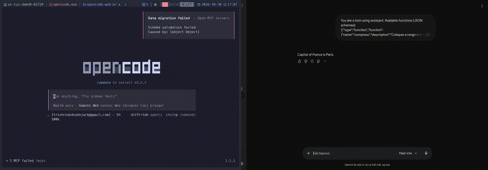

# opencode-web-bridges

Use **ChatGPT Web**, through your own logged-in session, as an OpenCode model.
No API key or launchd units are needed; the default prebuilt mode needs no Go toolchain. ChatGPT account access,
subscription requirements, and usage limits still apply; this does not bypass them.

The plugin manages everything: it downloads the
[chatgpt-proxy](https://github.com/bojackduy/chatgpt-proxy) binaries
(`chatgpt-openai` adapter + `chatgpt-proxy` MCP server) from GitHub releases,
injects the provider + MCP config, keeps the adapter and Chrome alive, and
guides first-run login.

## Demo



OpenCode TUI with the gemini-web model selected. A prompt is sent, the bridge drives your logged-in Gemini tab, and the reply comes back. Captured with asciinema (terminal) + Chrome DevTools Protocol (browser).

## Optional Gemini Web — local build, explicit opt-in

Gemini is available as a second **text-only** browser engine. Its release assets
are not published: build locally, do not assume the ChatGPT release downloader
can fetch Gemini. The default ChatGPT behavior remains unchanged.

```sh
go -C gemini-proxy build -o bin/gemini-openai ./cmd/gemini-openai
go -C gemini-proxy build -o bin/gemini-proxy ./cmd/gemini-mcp
./gemini-proxy/bin/gemini-openai -addr 127.0.0.1:8789 -chrome-port 9223 -profile "$HOME/.gemini-proxy"
```

Use a local parent plugin entry with these options (v1: `[package, options]`;
v2: `{ "package": package, "options": options }`):

```json
{
  "chatgpt": false,
  "gemini": {
    "proxyBinary": "/absolute/path/opencode-web-bridges/gemini-proxy/bin/gemini-proxy"
  }
}
```

`chatgpt: false` disables this plugin's ChatGPT registration/binary management
when an existing manual ChatGPT setup owns that service. Omit it to retain the
normal ChatGPT lifecycle. Gemini itself uses an **externally managed adapter**,
not a second plugin supervisor. Optional Gemini fields: `adapterBaseURL`
(default `http://127.0.0.1:8789/v1`, loopback only), absolute `profileDir`
(default `~/.gemini-proxy`), and `cdpPort` (default 9223). Provider and MCP
registration fills missing entries only. No global default model is changed.

Quit and restart OpenCode, then select **`gemini-web/gemini-web`**. On v2 the
plugin registers the provider through the provider domain using
`@opencode/ai/providers/openai-compatible`; it does not rely on a legacy SDK
package provider being converted correctly. MCP `gemini` runs the local binary
with explicit profile/port arguments.

Live verified on macOS with signed-in Vietnamese Gemini UI: exact Quill document
typing, marker and same-thread recall, exact-request cached completion identity.
Isolation uses its own tabs, profile and CDP port; wrong-profile listeners fail
closed. CDP focus emulation keeps only the owned page active so code-block
animations finish without stealing OS keyboard focus. This is **not full ChatGPT parity**: no projects, parallel browser
sessions, media inputs, chunked replay, or recovery UX. Streaming is buffered SSE,
not incremental generation. Windows profile verification is currently unsupported;
Linux and Windows have not been live verified.

## Optional DeepSeek Web — HTTP + SSE, no browser automation

DeepSeek is a third engine with a different shape: the adapter speaks the web
API directly (`/api/v0/chat/completion`, protobuf-style SSE patches, PoW
handshake), so there is **no Chrome, no CDP, no DOM scraping**. It needs one
thing from you: a token.

```sh
go -C deepseek-proxy build -o bin/deepseek-openai ./cmd/deepseek-openai
./deepseek-proxy/bin/deepseek-openai -login      # paste userToken, stored 0600
./deepseek-proxy/bin/deepseek-openai -addr 127.0.0.1:8790
```

Get `userToken` from a signed-in chat.deepseek.com: DevTools → Application →
Local Storage → `userToken`. `-login` accepts a bare token, a quoted one, or
`Bearer ...`; `DEEPSEEK_TOKEN` overrides at runtime.

```json
{
  "chatgpt": false,
  "deepseek": {
    "proxyBinary": "/absolute/path/opencode-web-bridges/deepseek-proxy/bin/deepseek-openai"
  }
}
```

Optional field `adapterBaseURL` (default `http://127.0.0.1:8790/v1`, loopback
only). Models: `deepseek-web`, `deepseek-reasoner` (thinking), `deepseek-expert`.
All advertise tool calling.

**Why revert, fork and model switch work here.** The client history is
authoritative and the journal only records what was actually submitted:

| incoming request | plan | what happens |
| --- | --- | --- |
| extends the committed history | `append` | only the new messages are sent, `parent_message_id` = last reply |
| same request after a failed turn | `retry` | the remote transcript is read back; nothing is resent |
| anything else (revert, edit, fork, model switch, compact) | `reseed` | fresh remote session, newest history rendered within budget (oldest trimmed first, newest turn never dropped) |

So there is no uncertain state to recover from: at worst you pay one reseed.
Logs are content-free (`plan=`, message counts, `prompt_bytes`, `tool_calls`,
`answer_bytes`, reason codes).

## Install

**Publication status:** this npm package is not published yet, and the bridge's
first GitHub release is still required for **prebuilt mode**. The default command
below needs both distributions; source mode needs the npm package published and
the chosen bridge commit pushed to GitHub, but no bridge binary release.

```sh
npx @bojackduy/opencode-web-bridges install
```

Prerequisites: **Node.js >=20 + npm**, **OpenCode v1 or v2**, **Bun >=1.1**
([installation](https://bun.sh/docs/installation)), and **Chrome/Chromium**
([Google Chrome](https://www.google.com/chrome/)). The installer itself runs in
Node, while the plugin uses Bun. Set `CHROME_BIN` to an existing browser executable
if its location is nonstandard. Neither browsers nor privileged services are installed.

The installer detects `opencode --version`, adds only the matching npm plugin
entry, and prepares **both** bridge binaries using release SHA-256 checksums
before changing config. It preserves comments, plugin options, existing manual
providers/MCP servers, and your default model. Existing registrations are
idempotent; explicitly disabled entries are reported and never enabled.
Existing files get a unique sibling `.bak` before an atomic replacement.
Malformed/ambiguous config or missing releases fail safely without config changes.
No source-build fallback is attempted.

```sh
# Preview exact config and required release assets, without spawning/downloading/writing:
npx @bojackduy/opencode-web-bridges install --host v2 --dry-run
# Explicit host/version detection override and exact config file:
npx @bojackduy/opencode-web-bridges install --host v1 --config /path/to/opencode.jsonc
```

`--host` accepts `v1`, `v2`, or `auto` (default). Dry-run requires an explicit
host because it does not execute `opencode`. Global config uses
`OPENCODE_CONFIG_DIR`, otherwise `$XDG_CONFIG_HOME/opencode`, otherwise
`~/.config/opencode` (OpenCode's XDG convention on Windows too, not `%APPDATA%`).
If more than one global JSON/JSONC file exists, select one with `--config`.
An existing ChatGPT entry under the wrong host's key requires migration rather
than adding a duplicate. No uninstall/update wizard or detached adapter is created.

Quit and restart OpenCode; select **`chatgpt-web/chatgpt-web`** in `/models`.
The plugin registers this provider/model **at runtime**; the installer does not
write manual model/provider/MCP definitions. On v2 run `/chatgpt-login` and
`/chatgpt-doctor`; on v1 ask the agent to call `chatgpt-login` and `chatgpt-doctor`.
Login once in the dedicated Chrome profile, not an API-key dialog.

### Explicit source-build mode (test pushed fixes before a binary release)

```sh
npx @bojackduy/opencode-web-bridges install --build-from-source --bridge-ref <tag-or-commit>
# Offline preview: no GitHub resolution, downloads, Go checks, processes or writes
npx @bojackduy/opencode-web-bridges install --build-from-source --bridge-ref <tag-or-commit> --host v2 --dry-run
```

Replace `<tag-or-commit>` with a real GitHub tag or commit. Both flags are required
together; there is no floating `main` default and no silent release-to-source fallback.
The configured `releasesRepo` (default `bojackduy/chatgpt-proxy`) selects the source
repository too. **Local/unpushed commits are not visible to this installer**:
the local `cf04b8f` tool/math fixes must first be pushed to that GitHub repository.
This feature does not push commits or publish the npm package for you.

Source mode requires the normal **Node >=20, OpenCode, Bun >=1.1 and Chrome**
prerequisites plus **Go compatible with the downloaded `go.mod`** and network access.
Go's normal `GOTOOLCHAIN` policy is respected: with `auto`, a sufficiently recent
Go launcher can download the required toolchain; with `local`, install a compatible
Go yourself. Go dependencies may also require network access. The installer runs
`go env GOVERSION` inside the downloaded module, then builds exactly
`./cmd/chatgpt-openai` and `./cmd/proxy` for your local platform (Windows uses `.exe`).
Source is user-selected executable code: trust the repository and ref. SHA-256
cache hashes detect changed artifacts; they are **not authenticity signatures**.

GitHub resolves the ref to a full immutable SHA before downloading its HTTPS
archive. Both successful builds and their metadata live in a repository/SHA/platform
cache. Only then is `bridgeSource: { "repo": "owner/repo", "commit": "<40-character-sha>" }`
persisted in the existing v1 `[package, options]` tuple or v2 `{package, options}`
object, preserving the package pin and other options. Reinstalling the same ref is
idempotent. Dry-run shows the requested mode/ref; the final SHA cannot be shown
without network access. At startup this option selects that exact verified cache,
never `latest` releases or an unexpected compilation. A missing/changed cache
fails with an actionable instruction to rerun the installer.

**Quit and restart OpenCode after selecting a build.** Run `/chatgpt-doctor` (or the
v1 tool) and verify the adapter process executable is the selected source-cache
`chatgpt-openai` path, not merely that `/ready` works. The managed source adapter
and MCP use the same selected binaries, Chrome port and profile arguments.
An already occupied adapter port is reported as a potential independent-service
or old-build conflict; the installer/plugin never kills it or overwrites its owner's
launchd unit. Have the service owner stop/reconfigure it, then restart OpenCode.
Existing manual MCP/provider entries are preserved, not silently replaced; check
their paths separately if you retain them.

### Why two repositories?

These are independent distributions, not two repositories users must clone:

```text
npm: opencode-web-bridges (OpenCode plugin + installer)
  -> GitHub release: chatgpt-proxy (checksum-verified Go executables)
  -> Chrome DevTools Protocol (CDP), dedicated signed-in Chrome profile
  -> ChatGPT Web, subject to the account's access and usage limits
```

[`opencode-web-bridges`](https://github.com/bojackduy/opencode-web-bridges) owns OpenCode
integration: runtime model/MCP registration, commands, and process supervision.
[`chatgpt-proxy`](https://github.com/bojackduy/chatgpt-proxy) owns the reusable Go
bridge: `chatgpt-openai` exposes the OpenAI-compatible adapter;
`chatgpt-proxy` exposes MCP browser tools. The bridge controls Chrome via CDP to
send prompts and read replies from the logged-in web session. Plugin users
download released executables automatically; they do **not** clone/build Go.
The installer never launches these processes; the plugin supervises them only
after OpenCode restarts.

### Manual plugin registration (alternative)

OpenCode v1 (`@opencode-ai/plugin` host):

```jsonc
// opencode.jsonc
{
  "plugin": ["@bojackduy/opencode-web-bridges"]
}
```

With options on current v1 hosts (older v1 schemas support strings only):

```jsonc
{
  "plugin": [["@bojackduy/opencode-web-bridges", { "version": "v0.2.0" }]]
}
```

OpenCode v2 (`@opencode/plugin` host) uses **`plugins`**, not `plugin`:

```jsonc
{
  "plugins": ["@bojackduy/opencode-web-bridges"]
}
```

With options on v2:

```jsonc
{
  "plugins": [{ "package": "@bojackduy/opencode-web-bridges", "options": { "version": "v0.2.0" } }]
}
```

The version option selects a **bridge release**, not the npm package version.
Use an existing bridge tag or omit it for `latest` (examples are not promised releases).

Quit and restart OpenCode after config changes, then select the
`chatgpt-web/chatgpt-web` model in `/models`.

## Host compatibility (v1 + v2, one install)

The same package covers **both** OpenCode generations; use the matching config
syntax above. The host selects `server` (v1) or `setup` (v2):

| Host | Mechanism | Provider | MCP | Commands |
| ---- | --------- | -------- | --- | -------- |
| OpenCode v1 | `server` + `config` hook (fill-missing-only) + `tool` map | `provider.chatgpt-web` injected | `mcp.chatgpt` injected | agent tools `chatgpt-status` / `chatgpt-login` / `chatgpt-doctor` |
| OpenCode v2 | `setup` + domain transforms (fill-missing-only) | `ctx.provider.transform` — same id, model, modalities, limits | `ctx.mcp.transform` — same name, same proxy command | slash commands `/chatgpt-status` / `/chatgpt-login` / `/chatgpt-doctor` (report posted back into the session) |

Notes:

- v2 needs **no config hook** — providers, MCP servers, and commands are
  first-class domains, so there is nothing to inject into.
- Both paths share one managed-binary lifecycle per process (whichever host
  loads wins — the supervisor never double-spawns) and the same
  never-clobber rule: pre-existing `chatgpt-web` / `chatgpt` entries are
  left untouched.
- On v2 the MCP entry registers the exact cache path up front and reloads
  once the background download lands, so no restart is needed.
- On v1 the config hook awaits the actual binary path before adding a new MCP
  entry. Failed downloads produce an error, never a placeholder executable.
  Existing manual MCP entries are preserved without waiting for downloads.

## First-run login

1. Restart OpenCode — the plugin reuses prepared binaries (or downloads them after manual registration) and starts the adapter.
2. On v2 run `/chatgpt-login`; on v1 ask the agent to call `chatgpt-login`: a Chrome window
   using the dedicated profile (`~/.chatgpt-proxy`) opens.
3. Log into ChatGPT there **once** — the session persists in the profile.
4. On v2 re-run `/chatgpt-status`; on v1 ask for `chatgpt-status` until ready.

## Commands

These are slash commands on v2, agent tools on v1. Bundled Markdown templates
in `commands/` can be copied into your v1 `.opencode/commands/` directory if you
want slash-command shortcuts; installing the npm package does not auto-copy them.

| Command           | What it does                                                              |
| ----------------- | ------------------------------------------------------------------------- |
| `/chatgpt-status` | ready / login / binary versions                                           |
| `/chatgpt-login`  | launch the profile Chrome window for one-time login, then re-probe        |
| `/chatgpt-doctor` | binary present+executable, port open, Chrome answering, login state, adapter version — each with repair hints |

## Options

| Option             | Default                  | Meaning                                                        |
| ------------------ | ------------------------ | -------------------------------------------------------------- |
| `releasesRepo`     | `bojackduy/chatgpt-proxy`| GitHub repo to download bridge binaries from (retarget forks)  |
| `version`          | `latest`                 | Release tag to download, or `latest`                           |
| `bridgeSource`     | unset                    | Installer-pinned `{repo, commit}` source cache; commit must be a full lowercase SHA. Overrides release selection, never builds at startup. |
| `profileDir`       | `~/.chatgpt-proxy`       | Chrome profile dir holding the ChatGPT login                   |
| `cdpPort`          | `9222`                   | Chrome remote-debugging port                                   |
| `adapterAddr`      | `127.0.0.1:8788`         | Adapter listen address (`-addr`)                               |
| `maxChars`         | `200000`                 | Per-turn paste budget passed to the adapter (`-max-chars`)     |
| `projectPerSession`| `false`                  | Set `CHATGPT_BRIDGE_PROJECT_PER_SESSION=1` for the adapter     |

Binaries land in `~/.local/share/opencode-web-bridges/<version>/` on macOS/Linux
(`%LOCALAPPDATA%\opencode-web-bridges\<version>\` on Windows);
logs in `~/.local/share/opencode-web-bridges/logs/`.

## Platform support

| OS      | Arch          | Status | Notes |
| ------- | ------------- | ------ | ----- |
| macOS   | arm64 + amd64 | arm64 development host; amd64 live unverified | Cross-built assets do not prove every host/architecture works live. |
| Linux   | amd64 + arm64 | ⚠️ built, paths covered, no live run yet | Chrome lookup covers distro packages (`/usr/bin`), `/opt` bundles, `/usr/local`, snap (`/snap/bin`), and `~/.local/bin`; cache follows XDG (`~/.local/share`). Set `CHROME_BIN` if your browser lives elsewhere. No live end-to-end run yet — please report yours. |
| Windows | amd64 + arm64 | 🧪 beta — cross-compiled + unit-tested, needs a live volunteer | See Windows notes below. |

Release assets: `chatgpt-openai-<goos>-<goarch>` / `chatgpt-proxy-<goos>-<goarch>`
(plus `.exe` on Windows) with `checksums.txt`, built from `ubuntu-latest`
via `GOOS=`/`GOARCH=` cross-compilation — no Windows runner involved.

### Windows notes (beta)

- **Install is identical**: add the plugin line, restart OpenCode, run
  `/chatgpt-login`. The first-run login flow is the same Chrome profile window.
- **SmartScreen**: the bridge binaries are unsigned, so Windows SmartScreen may
  warn on first download — choose "Run anyway" (details / more info). Binaries
  are sha256-verified against the release `checksums.txt` before first run.
- **Chrome lookup**: `%PROGRAMFILES%`, `%PROGRAMFILES(X86)%`, then the per-user
  `%LOCALAPPDATA%` install, in that order — or set `CHROME_BIN` to any path.
- **Profile dir** defaults to `%USERPROFILE%\.chatgpt-proxy` (same `~` default,
  resolved via `os.homedir()`).
- **Known limitations**: process cleanup kills the supervised child only (no
  POSIX process-group kill — unavailable on Windows); no Windows service /
  autostart integration — the plugin supervisor manages the processes while
  OpenCode runs.

## Troubleshooting

| Symptom | Fix |
|---|---|
| `Binaries still downloading` | Wait a few seconds and retry — first start downloads ~2 binaries. |
| `NOT READY: not logged in` | `/chatgpt-login`, log in once in the profile window, `/chatgpt-status`. |
| `CDP not answering` | `/chatgpt-login` relaunches the profile Chrome. |
| `checksum mismatch` | Delete the versioned cache dir above and restart opencode. |
| `unsupported platform` | Prebuilt binaries cover darwin-arm64, darwin-amd64, linux-amd64, linux-arm64, windows-amd64, windows-arm64. Build chatgpt-proxy from source and point `releasesRepo` at your fork. |

A failed turn always has a reason in the adapter log. Read it per request, not
per line: [docs/BRIDGE_LOGS.md](docs/BRIDGE_LOGS.md) maps every stage, the
flow-id timeline, and what each stopped stage means for retrying safely.

This uses your personal ChatGPT session (subject to its usage limits).

## Publishing (maintainers)

Do not publish from the Go repository. The npm package lives in
`/Users/duytrinh/Code/opencode-web-bridges`.

**Prerequisite:** `bojackduy/chatgpt-proxy` must have its first GitHub release
before another machine can download the bridge. Push bridge `main` through its
`personal` remote, choose an unused `vX.Y.Z` tag, and push that tag through
`personal`. Wait for `Release binaries` to finish and verify **12 binaries**
(two programs × darwin/linux/windows × amd64/arm64) plus `checksums.txt`.
The plugin defaults to `latest`; the release must not be draft or prerelease.

Push plugin `main` to `origin`, then do the **first npm publish manually**, once:

```sh
# Run in /Users/duytrinh/Code/opencode-web-bridges, NOT chatgpt-proxy
npm login
npm publish --access public --provenance=false
```

This runs prepack (typecheck, hermetic tests, build). First publication uses
your npm login without OIDC provenance; do not run the Actions publish workflow
until the package exists and its trusted publisher is configured.

On npmjs.com → `@bojackduy/opencode-web-bridges` → Settings → Trusted Publishers,
add GitHub Actions with owner **`bojackduy`**, repository **`opencode-web-bridges`**,
workflow **`npm-publish.yml`**, and **no environment** (the workflow has none).
No `NPM_TOKEN` is needed. Future releases use:

```sh
bun run release:patch  # or release:minor / release:major
```

These scripts check, bump/commit/tag the npm version, and push the branch and
tag. The tag workflow verifies the version, rejects already published versions,
stops on registry/network/auth errors, verifies prepack, publishes with OIDC
provenance, and creates GitHub release notes. Manual workflow dispatch must
select the matching `v<package-version>` **tag**; branches are rejected.
