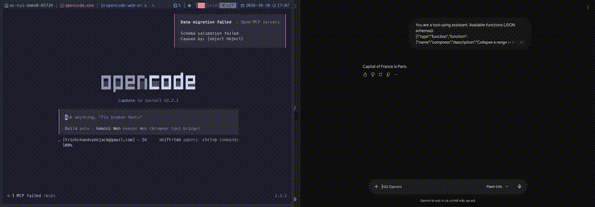

# opencode-web-bridges

## Use ChatGPT, Gemini, DeepSeek & Meta AI inside OpenCode — no API key

Turn your existing ChatGPT, Gemini, DeepSeek and Meta AI subscriptions into
OpenCode models. One install, no API key, no per-token billing.

### What it does

- **No API key needed** — uses your already-logged-in browser session
- **Four engines** — ChatGPT, Gemini, DeepSeek and Meta AI, side by side
- **One-line install** — `npx @bojackduy/opencode-web-bridges install`
- **Fail-closed recovery** — interrupted turns never re-submit
- **Checksum-verified** binaries for supply-chain safety
- **Open source** under AGPL-3.0

### Quick start

1. Install: `npx @bojackduy/opencode-web-bridges install`
2. Restart OpenCode, pick `chatgpt-web/chatgpt-web` in /models
3. Log in once with `/chatgpt-login`
4. Start coding

### Engines

| Engine | Type | Notes |
|---|---|---|
| ChatGPT Web | Browser (CDP) | Full features: projects, threads, recovery |
| Gemini Web | Browser (CDP) | Text-only, local build, batch support |
| DeepSeek Web | HTTP+SSE | No browser needed, needs a token, tool calls |
| Meta AI Web | Browser (CDP) | Meta AI models via browser session |

### Links

- [Landing page](https://bojackduy.github.io/opencode-web-bridges/)
- [GitHub](https://github.com/bojackduy/opencode-web-bridges)
- [npm](https://www.npmjs.com/package/@bojackduy/opencode-web-bridges)
- [Bridge logs](docs/BRIDGE_LOGS.md)
- [License (AGPL-3.0)](LICENSE)

### Prerequisites

Node.js 20+, OpenCode v1 or v2, Bun 1.1+, Chrome/Chromium.

### Support

Open an issue on GitHub. Include the adapter log stage and reason code.

---

Made with care by Duy Trinh. AGPL-3.0-or-later.
